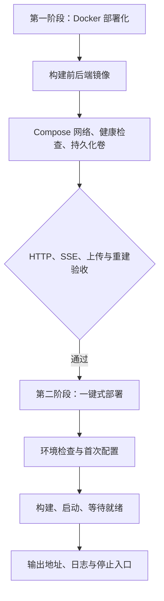

# Docker 两阶段部署工作流

[项目首页](../../README.md) · [文档导航](../README.md)

目标：首次配置模型凭据后，只依赖 Docker 就能构建、启动和管理本地项目。
本工作流按两个阶段交付，第二阶段复用第一阶段的 Compose 定义。



## 第一阶段：Docker 部署化

### 运行契约

| 项目 | 约定 |
| --- | --- |
| 后端 | Python 3.12 + `uv.lock` 锁定依赖；Uvicorn 单 worker；容器内监听 `0.0.0.0:7022` |
| 前端 | Node 22 + `npm ci` 构建 Vue；Nginx 提供静态文件并代理 API |
| 对外入口 | `http://127.0.0.1:8080`；只有前端映射宿主机端口 |
| 配置 | 根目录 `.env` 或进程环境变量；凭据只在运行时传入后端 |
| 数据 | Compose 命名卷 `interview-data` 挂载 `/app/data`；包含预设、快照、上传文件 |
| 健康检查 | 后端 `/`；前端 `/healthz` 透传后端，启动等待两个服务就绪 |
| SSE / 上传 | 关闭代理响应缓冲；300 秒读超时；允许 10 MiB PDF 加 multipart 字段 |
| 人物志 | 构建时导出 accepted 发布计划；镜像不包含阅读原文、历史工作流或本地会话数据 |

### 手动入口（不依赖第二阶段脚本）

安装并启动 Docker Desktop（macOS / Windows），或 Docker Engine + Compose（Linux）。
需要 Compose v2.24+ 或 v5；首次构建需要访问镜像仓库、PyPI 和 npm。

首次将 `env.example` 复制为 `.env`，已有 `.env` 时保留并补齐字段：

```dotenv
API_KEY='填写模型服务的密钥'
BASE_URL='https://your-provider.example/v1'
MODEL_NAME='填写模型名称'
TEMPERATURE=0.8
APP_PORT=8080
```

在仓库根目录执行：

```bash
docker compose up --build --wait --wait-timeout 120
docker compose ps
docker compose logs --tail=100
docker compose down
```

访问首页 `http://127.0.0.1:8080`，API 文档 `http://127.0.0.1:8080/docs`。
`APP_PORT` 可调整宿主机端口。Docker 模式固定 `DATA_DIR=/app/data`，避免使用宿主机的绝对路径。
宿主机上的模型服务可使用 `http://host.docker.internal:端口/v1`；容器里的 `localhost` 指向容器自身。

`down` 保留数据卷；不要使用 `down -v`，除非确实要删除保存的数据。
原有 `src/data` 中的个人数据不会自动迁移到新卷。多个副本请设置不同的 `COMPOSE_PROJECT_NAME` 和 `APP_PORT`，避免共用数据和端口。

### 第一阶段验收门槛

- [x] 构建两个镜像，不要求宿主机安装 Python、uv、Node 或 npm。
- [x] 两个容器健康，首页、静态资源、人物志、OpenAPI 和会话接口经同一个端口可访问。
- [x] 按当前 multipart 契约提交配置和 PDF，验证文件大小边界与数据写入。
- [x] 使用确定性的模拟模型服务验证真实 HTTP/SSE 链路；真实供应商另行验收。
- [x] 重建后端后，预设和 PDF 仍保留；新会话可用，旧内存会话失效。

## 第二阶段：一键式部署

在第一阶段验收通过后，用统一脚本封装检查、配置、构建和健康等待。
验收要求：首次配置有明确提示、已有配置不覆盖、任意工作目录可启动、重复执行可用、失败返回非零退出码、停止保留数据。

### 首次配置与日常启动

macOS / Linux 从仓库根目录执行：

```bash
./scripts/deploy.sh init
nvim .env
./scripts/deploy.sh up
```

首次填写模型三项后，日常只运行 `./scripts/deploy.sh up`。也可以直接运行 `up`，它会在缺少配置文件时创建模板并提示补齐字段。
macOS 支持双击 `start.command`：必要时启动 Docker Desktop，等待服务健康后打开浏览器。
双击启动的最近一次日志保存在根目录 `.docker-launch.log`（Git 忽略），方便窗口关闭后排查。
Windows 使用第一阶段的 `docker compose up --build --wait --wait-timeout 120`；当前不提供 PowerShell 包装脚本。

| 命令 | 用途 |
| --- | --- |
| `./scripts/deploy.sh doctor` | 检查配置、Compose 版本和 Docker 引擎；不调用模型 |
| `./scripts/deploy.sh status` | 查看容器与健康状态 |
| `./scripts/deploy.sh logs` | 查看并跟随日志，Ctrl-C 退出 |
| `./scripts/deploy.sh stop` | 停止容器，保留容器和数据 |
| `./scripts/deploy.sh down` | 移除容器和网络，保留数据 |
| `./scripts/deploy.sh url` | 输出实际访问地址 |

脚本可以从任意目录用绝对路径调用。使用其他配置文件时，设置 `AI_INTERVIEW_ENV_FILE=/绝对路径/配置文件`；后续管理命令使用同一配置文件和项目名。
`.env` 由 Compose 解析，不作为 shell 脚本执行；密钥建议使用单引号包围。不要把 `docker compose config` 的完整输出公开，它可能包含凭据。

### 可重复的第一阶段烟测

```bash
./scripts/test_docker.sh
```

测试创建唯一的 Compose 项目，使用 Docker 内的确定性模型服务，不读取真实模型密钥。测试覆盖页面、静态资源、全部发布人物志图片、当前 OpenAPI 契约、两轮 SSE（含进度实时到达）、10 MiB 上传边界和后端重建后的文件哈希。退出时只删除本次测试的容器、网络及测试数据卷。

第二阶段的脚本验收需要宿主机 Python 3（仅测试需要，日常部署不需要）：

```bash
python3 tests/docker/test_launcher.py -v
```

该测试使用临时配置和独立项目，验证首次配置、保留已有文件、敏感值不被执行或打印、错误配置、重复启动、端口冲突、停止及数据保留。

### 故障处理

- 配置未完成：脚本列出缺失字段后退出；填写 `.env`，再次执行 `up`。
- Docker 引擎未就绪：macOS 自动尝试启动并等待；其他平台先启动服务。
- 端口冲突：修改 `APP_PORT` 后重新执行 `up`。
- 容器不健康或构建失败：查看 `status` / `logs`，修复原因后重试；不会自动删除数据。
- 镜像拉取长时间没有进度且 Docker 凭据助手阻塞：本机 Unix socket 环境可在 `.env` 添加 `AI_INTERVIEW_ANONYMOUS_BUILD=1`，再运行 `up`。脚本只为公共镜像构建使用临时匿名客户端配置，结束后删除，不改原有 Docker 配置或凭据；远程 Docker 上不适用。
- 模型请求失败：健康检查不验证供应商，检查模型地址、名称、密钥与接口兼容性。

## 验收记录

2026-10-28，macOS / Apple Silicon，Docker Engine 29.2.1、Compose v5.1.0，Linux ARM64 容器。

| 阶段 | 验证与结果 |
| --- | --- |
| 第一阶段：镜像 | 后端 `uv sync --locked --no-dev --no-install-project`、前端 `npm ci` / `npm run build` 成功；人物志 2 个角色、17 个章节 |
| 第一阶段：服务 | 两个服务健康；页面、静态资源、全部人物志图片、OpenAPI 和 multipart 配置接口通过 |
| 第一阶段：SSE | 模拟模型经实际 HTTP 调用；两轮 message/done 正常；第二轮 progress 约 0.002 秒到达，最终事件约 3 秒到达 |
| 第一阶段：上传 | 10 MiB PDF 成功；10 MiB + 1 字节由后端返回 413；失败不覆盖已有文件 |
| 第一阶段：重建 | 后端重建后，PDF、预设、快照三份文件哈希一致；Nginx 无需重启即可连接新后端；旧会话 404，新会话正常 |
| 第二阶段：脚本 | `python3 tests/docker/test_launcher.py -v`，6 项通过；包括从含空格的其他目录调用、重复启动不重建未变化容器、端口冲突返回非零、停止后保留数据 |
| 本机运行 | 已复用本机现有模型配置启动当前 worktree；两个服务 healthy；浏览器首页与准备页加载正常；Finder 双击 `start.command` 后启动日志再次确认服务就绪 |
| 镜像边界 | 后端以非 root 用户运行；运行镜像中无 `.env` 或宿主机 `src/data`；前端运行镜像仅保留构建资源 |

当前凭据助手阻塞已在本机复现；脚本提供显式匿名公共镜像构建选项，验收未修改用户 Docker 全局配置。验收仅覆盖本机 Docker Desktop；Linux / Windows 宿主机未做实机验收。模拟模型证明部署链路，不代表真实供应商调用已验收，也不替代项目全量业务回归。

## 边界

- 持久化卷保存文件；当前 `InMemorySaver` 的会话不会跨重启恢复，也不能通过增加 worker 扩容。
- 默认只监听本机。当前应用没有完整身份认证，不将本工作流当作公网多用户部署方案。
- 健康检查证明服务就绪，不证明模型凭据或模型供应商可用。
- 此工作流用于运行构建产物；修改源码后重新执行构建启动。原有本地开发流程仍见各平台指南。

实现参考：[Compose 启动顺序](https://docs.docker.com/compose/how-tos/startup-order/)、[uv Docker 集成](https://docs.astral.sh/uv/guides/integration/docker/)、[Nginx 代理](https://nginx.org/en/docs/http/ngx_http_proxy_module.html)。
